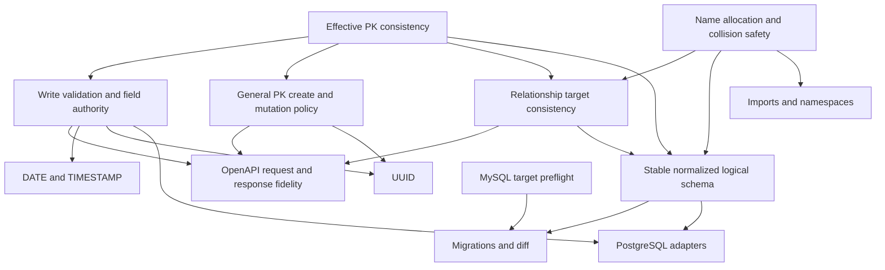

# APIForge verified gap analysis

Audit date: 2026-10-01 (Asia/Calcutta). Recommendation: **implement implicit-primary-key consistency next**, without new DSL syntax.

## 1. Baseline and authority

The audited compiler baseline is `e8ccc0acfe13d31422400637e2e0f0bd70405c01` on `main`. Initially `HEAD == origin/main`, ahead/behind `0/0`; `git ls-remote origin refs/heads/main` independently returned that same SHA. The only initial untracked paths were the four protected report-artifact roots listed below. No applicable `AGENTS.md` was found in the repository, `C:\Project`, or `C:\`.

This deliverable changes documentation only. No compiler, diagnostics, warnings, DSL, generated runtime, samples, dependencies, existing tests, or protected artifacts were edited. No push is authorized or performed. Current implementation and execution evidence take precedence over documentation and historical verification results.

The 61-error registry, WRN001–WRN005, ENUM, collection filtering/sorting/pagination, and the verified language guide remain frozen in this audit. A discovered baseline defect is reported, not repaired. The recommended future task may deliberately change faulty outputs and append a diagnostic if needed; that is separate work.

## 2. Audit scope

Inspected compiler and entrypoint files: `src/lexer/lexer.js`, `src/parser/parser.js`, `src/ast/ast.js`, `src/semantic/analyzer.js`, `src/ir/generator.js`, `src/optimizer/optimizer.js`, `src/codegen/codegen.js`, `src/utils/diagnostics.js`, `index.js`, `src/api/compiler-api.js`, `server.js`, and `package.json`.

Inspected frontend rendering, compile/API handling, escaping, copying and ZIP construction in `frontend/app.js`, and associated diagnostic/output styling in `frontend/style.css`. No live visual/browser-session acceptance test is claimed.

Reviewed the relevant language, PK, validation, SQL, relationship, optimizer, entrypoint, and artifact assertions in `tests/test.js`; the focused `diagnostics`, `warnings`, `enum`, `collection-query`, `string-length-validation`, `disk-generation`, `generated-backend-integration`, `generated-backend-mysql`, and `generated-backend-mysql-safety` test files; generated-backend/query/MySQL helpers; and all three compatibility fixtures under `tests/fixtures/`. Ran all eight offline suites and the existing language-guide verifier.

Read the authoritative `docs/APIForge-Language-Guide.md`, `docs/structured-diagnostics.md`, `docs/compiler-warnings-verification.md`, `docs/enum-support-verification.md`, `docs/collection-query-verification.md`, `docs/language-guide-verification.md`, `README.md`, `docs/verify-language-guide.js`, and the core/generated-backend/change-review skills and their architecture, current-DSL, project-map, known-behavior, generated-project-contract, backend-checklist and review-checklist references. Historical reports were used as contracts and coverage maps, not as current PASS evidence.

All nine `samples/*.apiforge` files were read and compiled/analyzed: seven valid samples succeeded; `dup_rel.apiforge` failed SEM024 and `invalid_rel.apiforge` failed SEM029 as intended. Local Express/mysql2 manifests and relevant mysql2 formatter, result-header and text-row parser code were inspected where runtime assumptions mattered.

Optimizer review found no additional demonstrated source-pipeline defect: semantics rejects duplicate declarations before optimization; direct-IR conflicts remain visible rather than silently selecting a declaration. Normalization preserves retained ENUM sourceLocations. IR currently retains only line metadata for most non-ENUM declarations, so richer future target diagnostics would need additional provenance; that is part of G22 planning, not proof that current located parser/semantic diagnostics are broken. CLI writes while API compiles in memory, and frontend downloads the API's exact file list; the offline suites/verifier confirmed those normal entrypoint contracts.

## 3. Executive summary

**28 verified gap records:** 9 correctness bugs, 6 consistency defects, 5 robustness gaps, 5 product capability gaps, 1 architectural limitation, 1 documentation/DX gap, and 1 testing gap. Severity: **0 CRITICAL, 6 HIGH, 16 MEDIUM, 6 LOW**. Capability and architecture records are explicitly not alleged runtime bugs. Some records share a root cause; these counts are an inventory, not independent incident counts.

The most consequential ordinary-input defect is implicit-key identity: SQL creates `id`, but item model CRUD addresses the first declared field. That field need not be unique. This can miss the requested row or update/delete several rows. The generated create response can also hide the database ID. A warning does not make this abstraction coherent.

Write validation is incomplete across common inputs. Relationship generation works for uncomplicated explicit-key examples but has source-implicit-key, reserved-identifier and target-collision failures. General entity-name transforms also collide. New datatypes, UUIDs, migrations and another database target would expand these unsettled contracts.

Previously undocumented **specific findings relative to the current language guide** include mutable-PK update succeeding before returning 404 (G13), non-auto-generated default-PK responses using insertId rather than the actual key (G12), prototype-sensitive symbol/schema omission (G14), and BOOLEAN read values escaping as numeric 0/1 (G23). Case-insensitive SQL column collisions (G10) and partially overwritten output after an I/O failure (G19) provide concrete cases beyond its general target-limit warning. Unsafe/overflow literals (G17) are a concrete escalation of its existing precision caveat, not a wholly new limitation. Ordinary STRING backslashes and ENUM trimming were already disclosed.

## 4. Classification, severity and estimates

HIGH means valid, plausible input materially breaks a target or its identity contract. MEDIUM covers narrower correctness, validation, robustness or schema mismatches. LOW covers absent conveniences or documentation. No CRITICAL claim is made: the implicit-delete query has a demonstrated multi-row hazard using an isolated query simulator, but this audit did not observe production data loss or certify a remotely exploitable vulnerability.

Effort is repository-relative: SMALL is a localized change and focused checks; MEDIUM crosses a few targets/fixtures/docs; LARGE adds a substantial subsystem or broadly changes contracts; VERY LARGE adds multi-target deployment/schema lifecycle work. Estimates are planning judgments, not measured durations. Risk concerns compatibility and implementation; leverage concerns future safety and reuse.

| ID | Verified gap | Classification | Severity | Effort | Risk | Leverage |
|---|---|---|---|---|---|---|
| G01 | Implicit SQL key differs from item CRUD/source relationship key | CORRECTNESS BUG | HIGH | MEDIUM | MEDIUM | HIGH |
| G02 | Ordinary `id` without PK collides with injected column | CORRECTNESS BUG | HIGH | SMALL | MEDIUM | HIGH |
| G03 | REQUIRED omission/null incompletely rejected before DB | ROBUSTNESS GAP | MEDIUM | MEDIUM | MEDIUM | HIGH |
| G04 | Scalar write type/integer/finite checks incomplete | ROBUSTNESS GAP | MEDIUM | MEDIUM | MEDIUM | HIGH |
| G05 | Body shape/property selection and write authority unguarded | ROBUSTNESS GAP | MEDIUM | MEDIUM | MEDIUM | HIGH |
| G06 | Validation/DB error statuses and exposure differ by endpoint | CONSISTENCY DEFECT | MEDIUM | MEDIUM | MEDIUM | HIGH |
| G07 | Relationship model SQL bypasses identifier quoting | CORRECTNESS BUG | HIGH | SMALL | LOW | MEDIUM |
| G08 | Relationships collide in physical and generated API names | CORRECTNESS BUG | HIGH | LARGE | HIGH | HIGH |
| G09 | Entity name transformations collide in files/routes/JS/OpenAPI | CORRECTNESS BUG | HIGH | MEDIUM | MEDIUM | HIGH |
| G10 | Case-distinct declared fields become duplicate MySQL columns | CORRECTNESS BUG | MEDIUM | SMALL | MEDIUM | MEDIUM |
| G11 | OpenAPI schemas differ from requests, records and envelopes | CONSISTENCY DEFECT | MEDIUM | MEDIUM | MEDIUM | HIGH |
| G12 | Defaulted/non-auto PK create response can expose key 0 | CORRECTNESS BUG | MEDIUM | MEDIUM | MEDIUM | HIGH |
| G13 | PK mutation updates a record, then looks up the old key | CORRECTNESS BUG | HIGH | MEDIUM | MEDIUM | HIGH |
| G14 | Prototype/metadata names lose symbols or schema properties | CONSISTENCY DEFECT | MEDIUM | MEDIUM | MEDIUM | HIGH |
| G15 | Ordinary STRING SQL defaults do not preserve backslashes | CONSISTENCY DEFECT | MEDIUM | SMALL | MEDIUM | MEDIUM |
| G16 | MySQL identifier/column/key limits lack target preflight | ROBUSTNESS GAP | MEDIUM | MEDIUM | MEDIUM | HIGH |
| G17 | Source numeric overflow/rounding propagates to targets | CORRECTNESS BUG | MEDIUM | MEDIUM | MEDIUM | HIGH |
| G18 | Native ENUM trimming conflicts with exact member semantics | CONSISTENCY DEFECT | MEDIUM | MEDIUM | MEDIUM | MEDIUM |
| G19 | Disk write failure can leave partially regenerated output | ROBUSTNESS GAP | MEDIUM | MEDIUM | MEDIUM | MEDIUM |
| G20 | Important target behavior lacks corrective regression coverage | TESTING GAP | MEDIUM | MEDIUM | LOW | HIGH |
| G21 | README runtime prerequisite is stale | DOCUMENTATION / DX GAP | LOW | SMALL | LOW | LOW |
| G22 | No single normalized effective generated schema/target plan | ARCHITECTURAL LIMITATION | MEDIUM | LARGE | HIGH | HIGH |
| G23 | BOOLEAN read representation disagrees with scalar API type | CONSISTENCY DEFECT | MEDIUM | MEDIUM | MEDIUM | MEDIUM |
| G24 | DATE/TIMESTAMP absent | PRODUCT CAPABILITY GAP | LOW | LARGE | MEDIUM | MEDIUM |
| G25 | UUID absent | PRODUCT CAPABILITY GAP | LOW | LARGE | MEDIUM | MEDIUM |
| G26 | Schema diff/migrations absent | PRODUCT CAPABILITY GAP | LOW | VERY LARGE | HIGH | HIGH |
| G27 | PostgreSQL target absent | PRODUCT CAPABILITY GAP | LOW | VERY LARGE | HIGH | HIGH |
| G28 | Imports/modules absent | PRODUCT CAPABILITY GAP | LOW | LARGE | HIGH | MEDIUM |

## 5. Verified gap evidence

Line references below refer to the audited baseline. Reproductions and observed output are expanded in [gap-analysis-verification.md](gap-analysis-verification.md). SQL/server-specific conclusions are separated from live database execution.

### Identity and write gaps

- **G01:** `src/codegen/codegen.js:345–352, 450–452, 778, 789–850, 876–892`. `getPrimaryKeyField` returns implicit INT id; `generateModel` independently falls back to `fields[0]`. Generated Student item SELECT/UPDATE/DELETE use `WHERE name = ?`, while collection filtering/order uses id. POST with mocked insertId 42 and `{name:'Alice',age:20}` returns only that submitted data: the provisional `name:42` is overwritten by the spread. A query simulator with two `name:'shared'` rows and the actual emitted DELETE removed both. This illustrates the emitted non-unique predicate; it is not a live-MySQL claim.
- **G02:** `codegen.js:450–452, 662–666`. `ENTITY Student / id STRING / name STRING` passes semantics with WRN001, then emits both `id INT PRIMARY KEY AUTO_INCREMENT` and `id VARCHAR(255)`. Collection metadata uses the declared STRING id, while OpenAPI path metadata calls id integer. An ordinary INT id also duplicates the column. This is an invalid schema, not merely a warning preference.
- **G03/G04:** `codegen.js:932–984, 1080–1090, 1122–1128`. Actual emitted controller functions and HTTP routers were exercised. Numeric bounds are JS comparisons, not type validation. Unbounded INT/FLOAT/BOOLEAN/STRING have no general scalar checks. Omitted REQUIRED always reaches the model; supplied REQUIRED null is rejected only by the ENUM-specific rule. Bounded STRING verifies type and Unicode code-point length when non-null; ENUM verifies exact string membership. See the full matrix below.
- **G05:** `codegen.js:881–888, 1080–1090, 1122–1128`. Validators return success for missing/non-object bodies and accept arrays. Both writes forward `req.body` directly. Real HTTP `{unknown:5}` and `[]` reached mock models. The installed mysql2 formatter turns `{unknown:1,parent_id:2,id:3}` into three assignments, including undeclared relationship columns and the PK. Unknown columns may become DB errors; valid physical extra columns can be written. This is missing selection/authority guarding, not demonstrated SQL injection or an authentication bypass in a product with no auth contract.
- **G06:** `codegen.js:1007–1059, 1092–1093, 1106–1108, 1118–1145, 1252–1255`. Model-thrown duplicate-entry text containing a private email is returned as HTTP 500 by create; update/item/relationship handlers similarly expose `error.message`. Collection DB errors are sanitized. Bound/membership errors return 400, absent CRUD records return 404, constraint failures generally become 500. The generated global handler converts malformed JSON to 500 too; the dev compiler's preserved INP002/500 policy is a separate documented contract.
- **G12:** `codegen.js:400–410, 880–883`. A PK with a DEFAULT is not auto-incremented, yet create always begins its response with `result.insertId`. For `key INT PRIMARY KEY DEFAULT 7` or `key STRING PRIMARY KEY DEFAULT "seed"`, a successful driver result with insertId 0 produces `{key:0,...submitted}` if the key was omitted. No query retrieves the actual defaulted key. Supplying a STRING key overwrites 0 via spread and works; omitting a STRING key without DEFAULT ordinarily fails at DB instead. The zero-insertId execution was mocked; live default insertion is unverified.
- **G13:** `codegen.js:885–889, 1128–1130`. Using the actual generated update/controller and a stateful pool simulator, PUT old with `{key:'new'}` first changes the STRING key to new, then SELECTs old, yielding 404 although the stored row changed. Define immutable-PK or supported-mutation semantics before expanding PK types.

### Names, relationships and representation

- **G07:** `codegen.js:799–815, 825–850` interpolates relationship table/PK identifiers directly. SQL DDL and ordinary CRUD use `quoteIdentifier`. `Parent.select STRING PRIMARY KEY -> Order MANY_TO_MANY` emits quoted DDL but `FROM Order` and `j.parent_select`/`t.key` without consistent quoting in its helpers. All four cardinalities have raw target-table interpolation; MANY_TO_ONE also has raw source table/source key, and MANY_TO_MANY has raw target PK, junction and FK identifiers. Values remain placeholders.
- **G08:** `analyzer.js:727–823` requires globally distinct source relation names, but `codegen.js:464–513, 787–850, 998–1064, 1168–1192, 1380–1482` names physical/API outputs from endpoint entities, ignoring relationName except comments/summaries. Distinct R1/R2 over the same pair produce duplicate junction tables or FK ADD COLUMN/constraint names, duplicate methods/controller functions/routes, and overwritten OpenAPI path entries. Declared `Child.parent_id` conflicts with a generated FK; declared entity `Parent_Child` conflicts with a generated junction. These are independently compiled accepted programs, not hypothetical names.
- **G09:** `codegen.js:118–144, 1224–1234, 1280–1336, 1539–1544`. Student/student duplicate controller/router paths and `const studentRoutes`; the emitted server fails JS parsing. Foo/FOO share `/foos` and case-insensitive Windows model filenames despite distinct exact filenames. Category/Categorie both pluralize to categories, causing router/OpenAPI collisions. No source-level uniqueness check covers these transforms. ZIP contains exactly the emitted list, so it cannot repair duplicated file paths.
- **G10:** `analyzer.js:313–333` compares exact field spelling. `name STRING` and `Name INT` compile together and emit two same-name MySQL columns under its case-insensitive column rules. The schema also has table-case portability limits. This audit reproduced acceptance/output; it did not import that schema. [MySQL identifier case rules](https://dev.mysql.com/doc/refman/8.0/en/identifier-case-sensitivity.html).
- **G11:** `codegen.js:1301–1379, 1400–1479`. Components omit implicit IDs and SQL-added FKs; shared POST/PUT schemas retain REQUIRED despite partial PUT semantics; optional null has no nullable declaration; PK generation/read/write roles are not modeled separately. Relationship responses advertise an array or entity directly while controllers wrap `{success,data}`. Most CRUD responses have only a description, not an incorrect explicit schema; they are underspecified. Most non-collection 400/404/500 responses are absent.
- **G14:** `analyzer.js:139–144, 210–223, 324, 694–699, 744–749`; `codegen.js:1276–1277, 1341, 1364, 1375`; `frontend/app.js:524–557`. Plain-object name registries use assignment/inherited lookup. Accepted entities `__proto__`, `constructor`, `relations`, `entities` disappear from the HTTP symbol-table inventory; relations/entities are also overwritten by non-enumerable compatibility metadata. `__proto__` entity has no own OpenAPI component; `__proto__` field is absent from own symbols/component properties; `__proto__` relation is absent from the relation-table keys although AST/IR still generates it. Frontend own-key rendering follows the missing inventory. This is local registry prototype handling; no process-wide Object.prototype pollution or remote code execution was demonstrated.
- **G23:** `codegen.js:540–557, 735–748, 876–878, 1111–1117`; installed `node_modules/mysql2/lib/parsers/text_parser.js:34–40`. SQL BOOLEAN uses the MySQL TINYINT representation; default mysql2 parsing returns a number. Executing the installed parser on a synthetic TINY value packet returns `{active:1}`; generated read models/controllers forward rows without conversion, while OpenAPI declares boolean. Create echoes a submitted `true`, so create and read representations can differ. This is driver/model evidence, not a live DB observation. [MySQL numeric type definitions](https://dev.mysql.com/doc/refman/8.0/en/numeric-type-syntax.html).

### Target limits, operational and coverage gaps

- **G15:** `codegen.js:156–164`. Source STRING default `"C:\new"` remains literal backslash+n in AST/OpenAPI, but SQL emits `DEFAULT 'C:\new'`. Under normal MySQL escape rules the database default contains a newline. ENUM doubles backslashes; legacy STRING does not. This is a generated-output/manual-supported mismatch, not a new runtime injection exploit. [MySQL string literals](https://dev.mysql.com/doc/refman/8.0/en/string-literals.html).
- **G16:** `lexer.js:285–295`, `analyzer.js:467–474`, `codegen.js:191–209`. A 65-character entity and `STRING MAX_LENGTH 100000` pass and emit that table name and VARCHAR(100000). MySQL table/column/constraint names have 64-character limits; row/column and indexed string capacities also depend on charset/engine/page format. A STRING PK/UNIQUE widened to 1000 characters can exceed a 3072-byte full-key limit with utf8mb4 on common InnoDB settings. Preflight must know target assumptions, including junction/constraint composed lengths, rather than impose an arbitrary universal character bound. [Identifier limits](https://dev.mysql.com/doc/mysql-reslimits-excerpt/8.0/en/identifier-length.html), [row limits](https://dev.mysql.com/doc/refman/8.0/en/column-count-limit.html), [InnoDB key limits](https://dev.mysql.com/doc/refman/8.0/en/innodb-limits.html).
- **G17:** `parser.js:533–640`, `analyzer.js:458, 596–613`, `ir/generator.js:143–167`. parseFloat rounds `9007199254740993` to 9007199254740992; a 400-digit FLOAT DEFAULT is accepted as Infinity. SQL emits `DEFAULT Infinity`, OpenAPI serializes default to null, and generated JS includes Infinity comparisons when such bounds are used. Source checks use Number.isNaN rather than finite/safe-target checks. Numeric storage bounds (MySQL INT/FLOAT) are also not generally enforced by the source contract.
- **G18:** `analyzer.js:354–369`, `codegen.js:192–194, 933–943`. Exact members `"a"` and `"a "` are accepted as distinct and preserved by runtime/OpenAPI, but native ENUM removes trailing declaration spaces. This can collapse members or return a trimmed value; strict modes govern native rejection. The generator does not set/verify sql_mode, and its ENUM backslash formatting assumes normal escaping. [Native ENUM rules](https://dev.mysql.com/doc/refman/8.0/en/enum.html). This mode-dependent result was not exercised live.
- **G19:** `codegen.js:93–109`. All content is generated before writing, so invalid IR/content generation safely precedes disk changes; however, filesystem writes happen one file at a time without transactional replacement or complete filesystem preflight. In a disposable output tree with old schema and `output/config` as a regular file, generation overwrote schema before rejecting config. Managed-directory cleanup itself is intentionally destructive for generator-owned files and preserves root user files, as existing tests verify. A file-symlink escape hypothesis was not verified: Windows refused the test symlink with EPERM; it is excluded from counted verified findings.
- **G20:** Main codegen tests largely assert output substrings; warning/collection fixtures deliberately freeze legacy item/write/relationship output; the guide verifier reproduces known limitations. ENUM/collection have stronger emitted-router checks, and live MySQL harness covers a conventional explicit INT-key MANY_TO_MANY project. Corrective regressions for implicit item identity, PK mutation, defaulted-key responses, target name transforms, all-cardinality quoted queries and prototype names are absent from the inspected corrective suite coverage. Passing totals do not certify those behaviors.
- **G21:** `README.md:393` says Node v14+; current `node_modules/express/package.json` specifies Node >=18. The generated manifest/README also supplies no explicit Node engines/minimum or lockfile. Documenting requirements is SMALL; lockfile reproducibility is a separate optional product decision. This mismatch was already reported in language-guide-verification, not newly discovered.
- **G22:** `codegen.js:278–352, 378–513, 662–666, 771–790, 1274–1379`. Separate extraction/resolution and representation rules derive keys, synthetic columns, writable fields and public schemas. No shared effective-schema plan carries key origin, generated columns, read/write roles and target-name allocation. This is an evidenced architecture limitation behind several bugs, not a request to rewrite the compiler now.
- **G24–G28:** `lexer.js:98–104`, `parser.js:200–340`, `codegen.js:174–209, 378–529, 1502–1554`, the current package/CLI commands, and guide section 15 establish five supported types, entity/relation-only declarations, MySQL-only generation and CREATE-schema output. No date/timestamp or UUID type, migration/diff lifecycle, PostgreSQL emitter, or module resolver exists. These useful missing capabilities do not invalidate ordinary supported programs.

## 6. Implicit-primary-key deep dive

Representative programs:

```apiforge
ENTITY Student
name STRING
age INT
```

```apiforge
ENTITY Student
id INT PRIMARY KEY
name STRING
age INT
```

| Phase/target | Implicit program | Explicit program |
|---|---|---|
| AST | name, age only; located source nodes | id/name/age; id PRIMARY_KEY |
| Semantic symbols | name/age only; WRN001 | id/name/age; no WRN001 |
| IR | CREATE_ENTITY + two declared ADD_FIELDs | CREATE_ENTITY + three ADD_FIELDs |
| Optimized IR | Still no id; no normalization invents a key | Explicit id preserved |
| SQL | Prepends id INT PRIMARY KEY AUTO_INCREMENT | Emits declared id INT PRIMARY KEY AUTO_INCREMENT |
| Model fields metadata | No id in `.fields`; id in QUERY_FIELDS | id in both inventories |
| Item GET | WHERE name = ? | WHERE id = ? |
| PUT | SET supplied properties WHERE name = ?; reread name | WHERE id = ?; reread id |
| DELETE | WHERE name = ?; may match many rows | WHERE id = ? |
| POST | DB insertion can work; `{name:insertId,...data}` hides ID | `{id:insertId,...data}` exposes ID for ordinary omitted auto key |
| Controller/router | Same envelope, validation, /students/:id | Same URLs and routing semantics |
| OpenAPI path/filter | id integer | id integer |
| OpenAPI component | name/age; no id | id/name/age |
| Collection GET | id filter and pagination key work against SQL id | id filter and pagination key work |
| Relationship DDL | Computes parent_id from implicit INT id | Computes parent_id from explicit id |
| Source relation helper | Uses first source field, contrary to DDL | Uses explicit PK |

Exact implicit-source relationship effects: ONE_TO_MANY/ONE_TO_ONE query `Child.parent_name` though SQL creates `parent_id`; MANY_TO_MANY list/add/remove query `parent_name` though the junction has `parent_id`; MANY_TO_ONE joins on `Parent.name` rather than `Parent.id`. Target-only implicit keys use getPrimaryKeyField and are coherent within helpers; if the target also lacks an explicit PK, its own item CRUD still has G01. Models' implicit `.fields` omission is metadata inconsistency, not a controller key-parser effect: controllers simply pass req.params.id.

Answers: this is a **partially broken abstraction intended as a convenience**. Collection access and insertion often work, but item identity, create key naming and source-side relationships are inconsistent. OpenAPI's integer id can disagree with a STRING first-field item predicate. Create does not reliably expose the implicit ID. The ordinary-id collision requires a deliberate rejection/resolution policy too.

Architecture options:

| Location to introduce implicit key | Advantages | Compatibility risks | Assessment |
|---|---|---|---|
| AST | Every later phase sees a field | AST stops representing declarations; synthetic locations; source-facing UI and warning logic change; all phase hash contracts move | Do not use for this repair |
| Symbols | Semantic effective schema visible | Source symbols diverge from AST; IR currently traverses AST, so symbols alone cannot fix targets; reserved metadata/prototype issue must be addressed | Not sufficient alone |
| IR | A normalized logical identity helps future migrations/targets | Instruction counts, phase snapshots, schema validation and existing WRN001 assertions change; need origin and allocation policy; do not inject MySQL AUTO_INCREMENT semantics into logical IR | Good later design, unnecessarily broad now |
| Shared codegen metadata | Keeps parsed/semantic/IR contracts stable; central effective PK and key origin for current targets | Generated model/schema hashes and faulty legacy identity change; consumers of model.fields need a declared/effective policy | **Preferred next milestone** |

Introduce one effective-key resolver/metadata object over codegen entity definitions and use it for every current key-dependent path. Existing getPrimaryKeyField already supplies the desired name/type fallback; extend/reuse that authority rather than another first-field rule. Keep logical identity separate from MySQL generation strategy. A later normalized-schema project can promote the logical metadata into IR if migrations or multiple targets warrant it.

## 7. Generated request-validation matrix

These are **pre-DB observations**, not acceptance by MySQL. `DB` means actual emitted validation/handler reached a mock model. Correct values yielded 201 POST or 200 PUT in the mock success path. POST/PUT share one validator; persistence/default semantics differ. There were 864 operation/type/required/value checks, twenty default/REQUIRED/UNIQUE checks, and real HTTP forwarding checks.

| Datatype | Operation | Omitted | Null | Correct JSON type | Wrong JSON type | Bounds/membership | Default | REQUIRED | UNIQUE | PK |
|---|---|---|---|---|---|---|---|---|---|---|
| INT | POST | DB | DB | DB, fractional also DB | `"20"`, `"abc"`, array/object reach DB unless coercive bound fails | Present non-null MIN/MAX comparisons only | DB default; no controller injection | Omission/null reach DB | DB-only | INT PK has no integer/safe/type check |
| INT | PUT | DB; empty object rereads | DB | Same | Same | Same | Omission retains old value | Omission allowed as partial update; null unguarded | DB-only | May mutate key; G13 |
| FLOAT | POST | DB | DB | DB | Strings/boolean/objects can reach DB | MIN/MAX comparisons, no general finite/type check | DB default | Omission/null reach DB | DB-only | Semantic PK rejected |
| FLOAT | PUT | DB | DB | Same | Same | Same | Omission retains old value | Same partial semantics | DB-only | Not allowed |
| BOOLEAN | POST | DB | DB | DB | `"false"`, number, arrays/objects reach DB | No bound syntax | DB default | Omission/null reach DB | DB-only | Not allowed |
| BOOLEAN | PUT | DB | DB | Same | Same | Same | Omission retains old value | Same partial semantics | DB-only | Not allowed |
| STRING | POST | DB | DB | DB | `123` reaches DB if no length modifier; bounded STRING rejects non-string | Present non-null code-point MIN_LENGTH/MAX_LENGTH | DB default | Omission/null reach DB, even with bounds | DB-only | STRING PK omission not checked; DB failure unless default |
| STRING | PUT | DB | DB | Same | Same | Same | Omission retains old value | Same partial semantics | DB-only | May mutate key; G13 |
| ENUM | POST | DB | Optional DB; REQUIRED 400 | Exact member DB | Non-string/member mismatch 400 | Exact case-sensitive membership; bounds prohibited | DB default | Omitted REQUIRED still DB; supplied null 400 | DB-only | Not allowed |
| ENUM | PUT | DB | Same | Same | Same | Same | Omission retains old value | Omitted REQUIRED allowed; supplied null 400 | DB-only | Not allowed |

Concrete boundary/type checks, both operations:

| Declaration | Supplied value | Observed generated validation |
|---|---|---|
| age INT MIN 18 MAX 60 | `20`, `20.5`, `"20"` | DB for all; fraction/string not rejected |
| age INT MIN 18 MAX 60 | `"abc"`, `{}`, `[20]` | DB through JS coercion/NaN comparisons |
| age INT MIN 18 MAX 60 | 17 or 61 / 18 or 60 | 400 / DB; inclusive boundaries executed |
| value FLOAT MIN 0 MAX 10 | 20, `"20"`, 20.5 | 400; bounds work without establishing type |
| value FLOAT MIN 0 MAX 10 | false or `"abc"` | DB |
| active BOOLEAN | `"false"` | DB |
| name STRING | 123 | DB |
| name STRING MIN_LENGTH 2 MAX_LENGTH 4 | `"abc"` / `"a"` / `"abcde"` / 123 | DB / 400 / 400 / 400 |
| value ENUM("active","inactive") | `"active"` / `"ACTIVE"` / false | DB / 400 / 400 |
| id INT PRIMARY KEY | 1.5 / 9007199254740992 / null | DB |
| Unbounded INT/FLOAT | Infinity / NaN passed directly to handler | DB; these are not ordinary JSON literals |

Bounds are inclusive. Existing focused tests and direct validator execution cover equality and Unicode code-point length; a proposed type validator must preserve them. JSON exponent overflow can produce a non-finite JS number during parse, but this audit's real HTTP matrix does not claim to have sent Infinity/NaN literals. Numeric bad types currently risk MySQL coercion/errors; exact DB effects depend on strict modes.

Defaults are SQL/OpenAPI metadata, not controller initialization. With REQUIRED+DEFAULT, omission may validly invoke the database default; a future REQUIRED policy should allow this. REQUIRED without DEFAULT on POST should reject omission, except an automatically generated PK. PUT currently means partial update despite its verb; rejecting every omitted REQUIRED field would break valid existing updates. UNIQUE should remain database-authoritative; map a duplicate-key failure safely rather than race with a precheck.

**Conclusion:** write validation is a valuable NEXT correctness/reliability milestone. It should cover type, body shape, property selection, optional null, generated-key/default exceptions, partial-update semantics and error mapping. It follows the narrower immediate identity repair because correct validation cannot fix the model's wrong WHERE predicate.

## 8. Relationship-generation review

Twelve generated variants were inspected/executed: four cardinalities times INT, STRING and implicit source/target keys. Value arguments were captured from the real emitted model methods. STRING FK types use the PK's VARCHAR capacity, not a hardcoded INT. Normal explicit-key query topology agrees with generated DDL; this does not certify every combination against MySQL.

| Cardinality | SQL storage / entity DELETE | Runtime helper/routes | Explicit INT/STRING | Implicit source | Missing related record / duplication |
|---|---|---|---|---|---|
| ONE_TO_ONE | Target-side nullable unique source FK; source delete CASCADE | source GET /:id/<lowerFirstTarget> | Names/types align unless G07/G08/G09 | parent_name mismatch | Singular missing result ->404; optional relationship, not mandatory exactly-one |
| ONE_TO_MANY | Target-side nullable source FK; source delete SET NULL | source GET /:id/<targetPlural> | Names/types align unless collisions/quoting | parent_name mismatch | Empty list ->200, without source existence check |
| MANY_TO_ONE | Source-side nullable target FK; target delete SET NULL | source GET /:id/<lowerFirstTarget> join | Names/types align unless collisions/quoting | WHERE source.name, not id | No joined row ->404; no distinct missing-source vs no association |
| MANY_TO_MANY | Junction with composite key; either entity delete CASCADE | source list/add/remove via targetPlural and targetId | Names/types align unless collisions/quoting | parent_name in list/add/remove | Duplicate insert ->DB error ->500; missing FK ->DB error ->500; remove false ignored ->200 |

The delete actions above are emitted DDL evidence, not observed cascade execution. Explicit INT/STRING OpenAPI path types match their owning source/target keys, including STRING target association IDs. Relationship response content is miswrapped (G11). Association deletion's 200 for absence can be an idempotent design choice; it is not separately counted as a bug. The code does not promise that list GET distinguishes a missing parent from an empty collection.

Collision inventory:

| Target | Accepted reproducer | Consequence |
|---|---|---|
| FK column/constraint | Parent R1 Child ONE_TO_MANY + R2 ONE_TO_ONE | duplicate parent_id and constraint allocations |
| Declared vs synthetic column | Child declares parent_id plus Parent->Child | ADD COLUMN conflicts |
| Junction | Two distinct MANY_TO_MANY relations over Parent/Child | CREATE TABLE Parent_Child twice |
| Declared vs junction table | Entity Parent_Child plus Parent->Child MANY_TO_MANY | duplicate table |
| Model/controller/routes/OpenAPI | Same endpoint pair and cardinality with distinct relation names | duplicate methods/functions/routes; later OpenAPI overwrites |
| Relationship vs collection controller | Category->Categorie ONE_TO_MANY | both getCategories; executing the exported collection handler called the relationship model method with undefined source id, in addition to route plural collision |

No relation-name-qualified storage/route scheme exists. A future fix must first decide whether to reject ambiguous accepted combinations or allocate distinct names; silently adding suffixes would change public URLs/schema. Quoting repair can be small, but collision-safe relationship naming is a larger contract task.

## 9. Narrow generated-runtime security review

Collection requests have strong existing defenses: only QUERY_FIELDS can choose columns; fixed asc/desc tokens select order; field/order injection names are rejected; filter values/LIMIT/OFFSET are bound by mysql2 pool.query; filters use null-prototype storage and own-property checks. Existing collection tests execute string attack values and malformed options. The audit additionally ran the installed mysql2 formatter with an apostrophe/SQL attack string: it remained an escaped value under the driver's normal escape assumptions.

Ordinary CRUD and relationship values are passed as placeholders/object binding. DSL identifiers are restricted to ASCII letters/digits/underscore, so raw relationship identifier interpolation demonstrates reserved-word correctness failure rather than a demonstrated request-controlled identifier injection. Request bodies cannot select table names. Collection unknown keys cannot select arbitrary fields.

Concrete concerns are exposed database error messages (G06), arbitrary writable physical properties/PK mutation (G05/G13), coercive/unvalidated bodies (G03/G04), and local name registry prototype handling (G14). Runtime SQL uses mysql2 query formatting, not server-side prepared statements; SQL-mode assumptions matter. A driver mode incompatibility is recorded as uncertainty, not a proven exploitable injection. No authentication system or authorization policy exists to audit; no full security certification is implied.

## 10. OpenAPI/runtime mismatch inventory

G11 covers omitted implicit id/FK properties, incomplete read/write/default/generated-key roles, required POST/partial PUT reuse, optional-null mismatch, unwrapped relationship response schemas, and missing errors/CRUD envelopes. G23 adds actual BOOLEAN scalar representation. G01/G02 make path id metadata disagree with model identity in implicit/colliding cases. G09/G08 can lose schemas/operations through target path overwrites; G14 can lose own component keys. G17 makes an overflowing numeric default become OpenAPI null.

Collection parameters/headers/type parsing agree in the normal cases tested. Reserved query control names deliberately disable same-name filtering, pagination is opt-in, and data/count use separate reads: concurrent count drift is an explicitly documented limitation, not newly classified as a bug. OpenAPI should improve after identity and write contracts settle rather than document unstable behavior as a final contract.

## 11. Candidate milestones and prioritization

User value/risk/leverage are qualitative. Severity addressed refers to existing findings; new capability rows are LOW because no broken current supported behavior is fixed. Exactly one milestone receives NOW.

| Candidate | Category | Severity addressed | User value | Effort | Risk | Architectural leverage | Dependencies | Recommended timing |
|---|---|---|---|---|---|---|---|---|
| A. Implicit-PK consistency | Correctness | HIGH G01/G02; focused G11 identity | HIGH | MEDIUM | MEDIUM | HIGH | Shared effective-key policy and collision decision | **NOW** |
| B. Generated request validation | Robustness/consistency | MEDIUM G03–G06; coordinate HIGH G13 | HIGH | MEDIUM | MEDIUM | HIGH | A; decide writable/generated/default/partial/null semantics | NEXT |
| C. Relationship generation/collision safety | Correctness | HIGH G07/G08 | HIGH | LARGE | HIGH | HIGH | A; naming/allocation policy with J | NEXT |
| D. DATE/TIMESTAMP | Product capability | LOW G24 | MEDIUM | LARGE | MEDIUM | MEDIUM | B; timezone/serialization/SQL/default policy | LATER |
| E. UUID | Product capability | LOW G25 | MEDIUM | LARGE | MEDIUM | MEDIUM | A/B; settle general PK create/mutation G12/G13 and UUID generation/storage | LATER |
| F. Schema migration/diff | Product capability/architecture | LOW G26; MEDIUM G22 prerequisite | HIGH | VERY LARGE | HIGH | HIGH | Stable normalized schema, target naming, operation ordering, rename/data/backfill policy | LATER |
| G. PostgreSQL target | Product capability/architecture | LOW G27 | MEDIUM | VERY LARGE | HIGH | HIGH | G22 target adapters; A/B/C/J; independent identity/enum/types/quoting/driver contract | LATER |
| H. Imports/modules | Product capability | LOW G28 | MEDIUM | LARGE | HIGH | MEDIUM | Symbol namespace/prototype safety, global names, resolver/cycle/source-location contracts | OPTIONAL |
| I. OpenAPI fidelity | Consistency | MEDIUM G11/G23 | HIGH | MEDIUM | MEDIUM | HIGH | A/B/C/J; decide runtime serialization/envelopes then separate schemas | NEXT |
| J. Generated naming/collision validation | Correctness | HIGH G09; MEDIUM G10/G14 | HIGH | MEDIUM | MEDIUM | HIGH | Deterministic physical/JS/file/route allocation rules; coordinate C | NEXT |
| K. General PK create/update contract | Correctness | HIGH G13; MEDIUM G12 | HIGH | MEDIUM | MEDIUM | HIGH | A; immutable vs mutable key decision, defaulted-key response policy; coordinate B | NEXT |
| L. MySQL target/literal preflight | Robustness/correctness | MEDIUM G15–G18 | MEDIUM | MEDIUM | MEDIUM | HIGH | Explicit supported versions/modes/charset/engine; share B numeric policy | NEXT |
| M. Atomic disk output and runtime prerequisites | Robustness/DX | MEDIUM G19; LOW G21 | MEDIUM | MEDIUM | MEDIUM | MEDIUM | Define replacement/failure ownership; version contract | OPTIONAL |

## 12. Dependencies



B/J/C/K/L can be separately scoped after A; NEXT is a queue, not authorization to implement them together. J has no hard dependency on A, but source identity must be stable before allocating relationship outputs. M is largely independent. DATE needs date-only vs instant/timezone semantics, not just a lexer token. UUID can already be stored manually in STRING; a dedicated UUID capability adds generation/format/storage semantics that current STRING support does not establish. Migration safety requires a logical schema plus provenance and an explicit destructive-change policy. Adding PostgreSQL by cloning this MySQL generator would replicate identity/validation/name defects and encode incompatible AUTO_INCREMENT/ENUM/object-binding assumptions.

## 13. Exactly one recommendation

**A: make implicit primary keys consistent across generated targets.** Fix the existing convenience feature's identity, using one shared effective-key definition, and reject unresolved ordinary-id collisions before writing artifacts. Do not change DSL syntax.

It happens now because the smallest plausible entity program can produce wrong item predicates, hide its ID and misaddress source relationships; a non-unique first field can affect multiple rows. These are stronger correctness failures than missing date/UUID/module features. Write validation has high value but cannot correct identity predicates. Broad relationship/naming work requires policy choices and has greater compatibility risk. OpenAPI should then reflect the repaired identity.

Expected ownership is principally `src/codegen/codegen.js`, focused tests/new audit-derived corrective tests, relevant compatibility fixtures, the Language Guide/verifier and generated-project contract/reference. `src/semantic/analyzer.js`/`src/utils/diagnostics.js` and diagnostics tests are affected only if the ordinary-id collision is rejected during semantic analysis using an appended code. AST/IR/optimizer/frontend API shape need not change. The compiler API/browser ZIP automatically receives current generatedFiles; exercise these surfaces without adding UI features.

Risk: some consumers may rely on the broken first-field item behavior or create response; fixing it is an intentional generated contract correction. Valid explicit-key artifacts should remain unchanged except explicitly justified identity-schema changes. Phase representations and public diagnostic assignments stay stable. Declared non-PK id is not safe to silently promote, especially STRING id; rejection is the preferred proposed policy for that already-broken target combination. Approval of a later implementation task must explicitly authorize any appended error/changed acceptance for that case.

## 14. Proposed next-task scope

### IN SCOPE

1. Define canonical effective key name/type/origin for explicit INT, explicit STRING and implicit INT id, reusing current key resolution rather than synthesizing source declarations.
2. Use it in item findById/update/delete, create response key naming, every source/target relationship key/FK reference, collection metadata/order and OpenAPI identity metadata.
3. Ensure implicit create returns its generated id when not supplied; do not let a first declared field overwrite it. Define policy for a caller supplying implicit id, preserving supported database semantics rather than guessing zero/null behavior.
4. Preserve declared/effective field inventories deliberately: keep AST/symbols/IR source-faithful and expose implicit identity in the relevant generated/read schema metadata. Mark implicit id's generation/read role so POST requirements do not become stricter accidentally. Avoid claiming complete response schemas until I.
5. Reject a declared ordinary id that conflicts with implicit allocation, including casing under the selected target policy. Prefer a precise semantic error with one appended code if authorized; no renumbering or repurposing of the existing 61 codes.
6. Update documentation/tests/fixtures only for those deliberate identity changes; review explicit-key compatibility separately.

### OUT OF SCOPE

New syntax/types, UUID/date support, migrations/PostgreSQL/modules, generic request validation/default injection, whole OpenAPI redesign, relationship output renaming/cardinality/delete-policy changes, arbitrary naming refactors, general PK mutation/defaulted explicit-key repair, SQL-mode/literal redesign, frontend styling, package dependencies and atomic disk generation. Record any independently discovered defect; do not silently fold it in.

### COMPATIBILITY REQUIREMENTS

Preserve root plural routes and `:id` parameter names; collection filters/sort/pagination/defaults/headers; `{success,data}` envelopes; explicit STRING key typing/FK width; explicit INT AUTO_INCREMENT/default policy; SQL relationship deletion actions; ENUM/membership/length behavior; warning codes and WRN001 located source wording; error code assignments; CLI/API phase/status shape; browser ZIP file list; generator-owned cleanup and protected artifacts. Unrelated explicit-key generated files should remain byte-identical.

AST, semantic symbol inventories, IR instruction counts and optimized IR remain unchanged for no-PK programs. Preserve existing source locations. If a future implementation instead chooses normalized IR, treat that as a separate architecture proposal with explicit fixture/UI/API compatibility scope.

### TEST REQUIREMENTS

- Execute emitted model/controller/router behavior, not only string assertions: non-unique first-field rows, numeric/string first fields, a PK not in first position, two records with equal first fields, and CRUD using real effective id.
- Prove implicit create exposes insertId without replacing name/age; follow it with GET/PUT/DELETE by that id.
- Exercise all four relationship cardinalities with implicit source, implicit target, both implicit and explicit INT/STRING control cases. Inspect quoted/key query identifiers and values; existing unrelated G07 quoting limitations remain separately tracked.
- Verify collection id filtering/sort/tie-breaking and OpenAPI path/identity metadata remain coherent.
- Test ordinary id collisions and casing, exact diagnostic/phase behavior if rejection is approved, and ensure errors cause no disk/ZIP partial success.
- Use scoped compatibility hashes that exempt only intentionally changed implicit-key sections; never recapture every baseline blindly to make tests pass.
- Run npm test, language-guide verifier, diff checks and generated JS/JSON syntax checks. Extend the opt-in safe MySQL harness for actual implicit CRUD/relationship persistence and clean temporary DB/port/project when credentials are available. Do not equate mock success or /health with DB correctness.

### GENERATED ARTIFACT REQUIREMENTS

SQL, model metadata, CRUD/source/target helpers, controller responses and OpenAPI must resolve the same identity. Preserve SQL schema for valid ordinary implicit entities and explicit-key controls, file paths/counts and runtime dependencies. Return the same corrected generatedFiles via CLI/API/ZIP; disk verification uses a temporary working directory, preserving repository output and user-owned root files.

### DOCUMENTATION REQUIREMENTS

Revise guide section 6 and generated behavior/limitations sections, generated-project contract, related verification notes and reproducible guide assertions. Explain the changed legacy implicit item behavior, create ID, collision rejection and retained limitations. Keep unrelated diagnostics/ENUM/collection claims and source examples intact. Include exact before/after runtime evidence, not a general production-ready claim.

## 15. Verification and artifact safety

See [gap-analysis-verification.md](gap-analysis-verification.md) for repeatable commands, an embedded audit probe, source/output observations and protected-artifact manifest. Only these two new Markdown files form the deliverable; temporary scripts/logs/results were kept outside the repository and removed after recording evidence.

| Command/check | Result |
|---|---|
| npm test | Exit 0: main 1060/0; STRING length 25; disk/safety PASS; diagnostics 53; warnings 26; ENUM 16; collection 9 groups |
| node docs/verify-language-guide.js | PASS: 18 valid/59 invalid; 120 generated JS parsed; 77 real CLI runs isolated |
| Embedded generated-code audit probe | 864 validation cases, 20 default/constraint cases, 12 relationship variants, 16 named cases; 10 emitted-router HTTP writes; 6 compiler API probes; scalar driver/formatter and disk-failure reproductions |
| git diff --check and staged diff check | PASS |
| Live remote baseline | Matches expected main SHA |
| Live MySQL | No configured APIFORGE_TEST_DB_* credentials; generated default localhost/root/empty-password probe denied ER_ACCESS_DENIED_ERROR; no DB/schema created |
| Opt-in install/start/MySQL integration | Not run; install/start cannot verify these DB failures and unavailable credentials prevent live DB evidence |

Protected artifact roots: `APIForge_Drive_Resources.zip` (1 file, 4,267,514 bytes), `APIForge_Drive_Resources/` (18 files, 5,489,267 bytes), `APIForge_Overleaf_Source/` (16 files, 1,191,761 bytes), `APIForge_Overleaf_Source__FINAL.zip` (1 file, 1,029,692 bytes). Before/after exact path lists, counts, lengths, SHA-256, creation and modification timestamps matched for all 36 files. They were never staged. The final commit is local documentation only; final SHA/ahead-behind/status are reported at delivery rather than embedding a self-referential commit hash here.

## 16. Remaining uncertainty

Live MySQL version, charset/engine/page size/sql_mode/lower_case_table_names and actual constraint/cascade/default/coercion behavior were not measured because the available default connection was denied. SQL-output defects and explicit manual-backed assumptions remain actionable, but database-specific error codes/conditions should be confirmed with the isolated opt-in harness before implementation sign-off. No unrelated database was accessed or provisioned.

The file-symlink-write concern is unverified on this host (EPERM), and is not counted as a verified bug. No full security test, concurrent load test, dependency install/start refresh, live browser visual audit or alternate-platform filesystem run is claimed. Public API response shape, source phase identity and request semantics need explicit decisions in the later tasks described above. The audit supplies a reviewable plan; it does not authorize its implementation.
